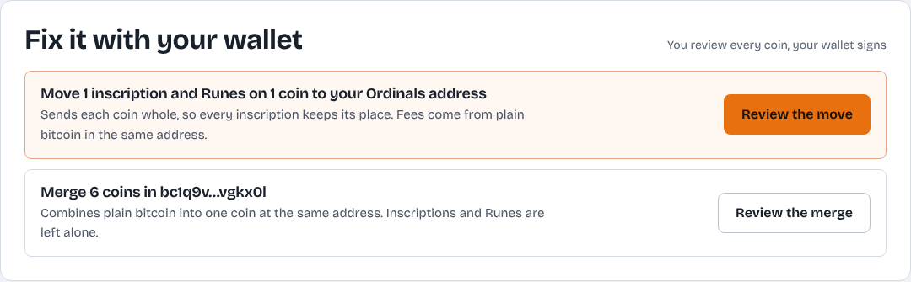
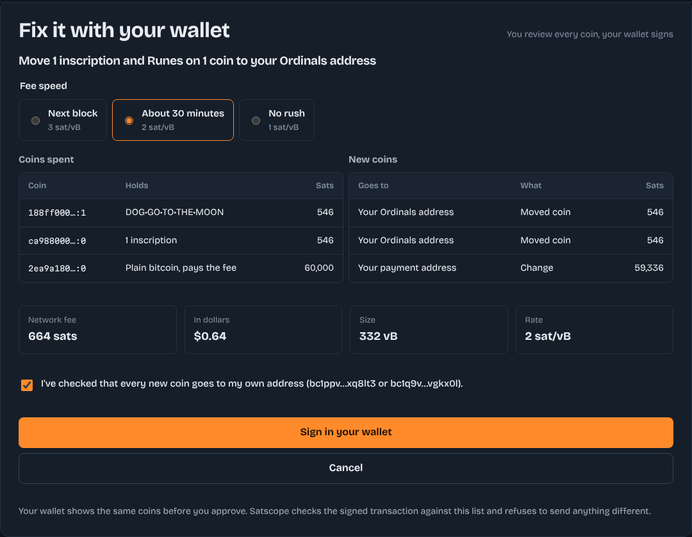
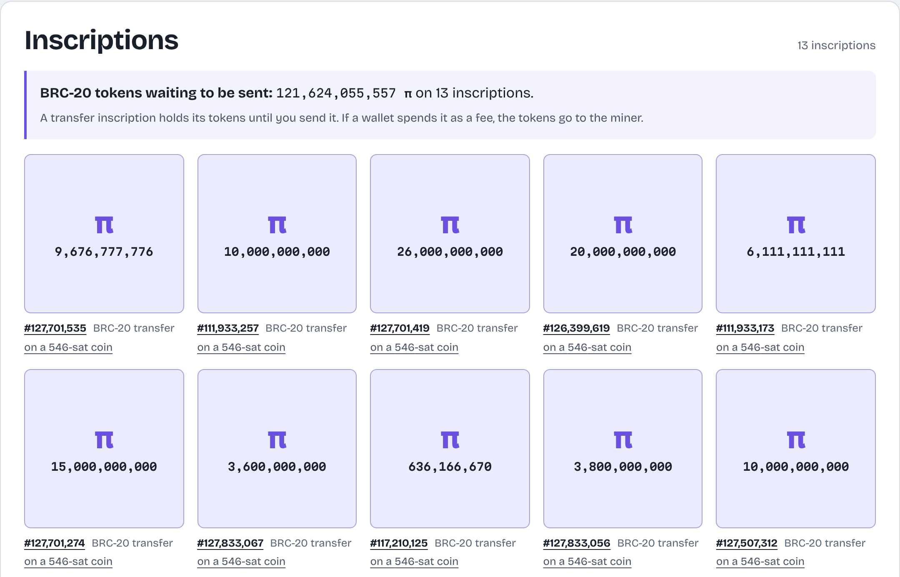

# Satscope

**A free Bitcoin wallet checkup.** Paste any address or connect a wallet, and Satscope shows every coin in it: plain
bitcoin, Ordinals inscriptions and Runes. It warns you before an inscription gets spent as a fee, prices each coin at
today's fee rate, and lets you prove you own an address with a signed message.

**Live: [satscope.vercel.app](https://satscope.vercel.app)**


## Why it exists

Bitcoin wallets show one balance, but a balance is made of separate coins (UTXOs). That is where Ordinals users lose
inscriptions: a wallet that doesn't track them treats a 546-sat inscribed coin as small change and spends it on the next
fee. Satscope looks at each coin and tells you, in plain words, what could go wrong and what to do about it.

## What it checks

| Check                                                  | What you see                                                 |
| ------------------------------------------------------ | ------------------------------------------------------------ |
| Inscriptions or Runes in a payment address             | High-risk warning, with the exact coins and how to move them |
| Extra sats stuck to an inscription                     | How much bitcoin rides along with each inscription           |
| Several inscriptions or Runes on one coin              | Coins whose assets can't be sent separately                  |
| Coins worth less than the fee to spend them            | Priced at the current no-rush fee rate                       |
| Many small coins                                       | Cost to merge them today versus on a busy day                |
| Legacy address types, address reuse, unconfirmed coins | Short notes with the reason                                  |

Every finding feeds a 0 to 100 health score with a grade. The score describes how the coins are set up; it isn't
financial advice.

| Wallet report                               | Every coin, to scale                       | Mobile                                 |
| ------------------------------------------- | ------------------------------------------ | -------------------------------------- |
|  |  |  |

## One-click fixes

Finding a problem is half the job. When inscriptions or Runes sit in a payment address, or plain coins pile up,
Satscope builds the fix as a PSBT for your wallet to sign:

| Pick a fix                                       | Review every coin, then sign                         |
| ------------------------------------------------ | ---------------------------------------------------- |
|  |  |

- **Move to the Ordinals address:** each at-risk coin is spent whole and becomes an output of the same value at the
  same position, so every inscription keeps its offset (sats are assigned first in, first out). A Runes-only coin goes
  first: with no runestone, all Runes land on output 0, and that keeps them off inscriptions. Fees come only from
  index-checked plain bitcoin, and change returns to the payment address.
- **Merge plain coins** into one coin at the same address, at the fee speed you choose. Coins that would cost more to
  spend than they hold are left out.
- **Safety checks before anything is sent:** the wallet's public keys must produce the addresses being spent; the
  signed transaction must spend exactly the reviewed coins and pay exactly the reviewed outputs; every signature must
  commit to the whole transaction (`SIGHASH_ALL` or Taproot default). Only then does a second click broadcast it to
  mempool.space. Replace-by-fee is on, the fee rate never drops below 1 sat/vB, and change below dust goes to the fee.
- Works with Taproot, Native SegWit and Nested SegWit inputs, so Xverse, UniSat, Leather and Magic Eden users are
  covered.

The flow is tested end to end with a mock Leather wallet that really signs, using the public key from the BIP-322 test
vectors, with the broadcast intercepted.

## Inscription gallery

The report shows every inscription as it looks, not as a list of IDs. A BRC-20 transfer inscription becomes a token
card with its ticker and amount, and Satscope adds up the tokens still waiting to be sent, using exact decimal maths.
Images show as pictures (small ones as crisp pixel art), short text shows as text, and HTML, SVG, video or 3D
inscriptions play in a sandboxed frame from ordinals.com. Coins in a payment address come first and are outlined,
because those are the ones a wallet could spend as a fee. Each tile links to its coin in the table and to ordinals.com.



- Details come from ordinals.com's recursive endpoint (`/r/inscription/<id>`) on the server, cached for 30 days because
  an inscription never changes. The gallery streams in with React Suspense, so the rest of the report doesn't wait.
- Images load with ``, which can't run scripts. Everything else goes in an `<iframe sandbox="allow-scripts">` on
  ordinals.com's own origin, and the Content Security Policy allows only that host for frames and images.

## Features

- **Wallet connect with [LaserEyes](https://github.com/omnisat/lasereyes-mono):** Xverse, UniSat, Leather, Magic Eden,
  OKX, Phantom, Oyl, Wizz, Orange and more. Satscope reads the Ordinals and payment addresses and checks them together,
  then disconnects. The 3 MB library loads only when someone opens the wallet list.
- **Coin map:** every unspent output drawn to scale (log of its value) and coloured by what it carries. Each coin links
  to its row in the table, and the map works with a keyboard.
- **Ownership proofs (BIP-322):** sign a dated message with your wallet and share a link. Nothing is stored; the link
  carries the address, message and signature, and the page verifies it again on every visit.
- **Signature verifier:** checks BIP-322 signatures from Ordinals wallets and classic signed messages from Electrum,
  Sparrow and Bitcoin Core.
- **Honest when data is missing:** if the Ordinals index doesn't answer, the report says so and marks postage-sized coins
  "check first" instead of calling them safe.
- **Guides** on Ordinals safety, UTXO consolidation, dust and proving ownership.
- Light and dark themes with no flash, keyboard focus everywhere, reduced-motion support, and WCAG AA contrast checked
  by tests.

## How it works

```
Address or wallet ──► /address/[addr] or /wallet?o=…&p=…   (server components)
                          │
                          ├─ mempool.space  (coins, history, fees, price)   ← blockstream.info backup
                          ├─ UniSat Open API (inscriptions and Runes per coin, optional key)
                          ├─ ordinals.com   (inscription content types and BRC-20 text, for the gallery)
                          │      all cached in the Vercel Runtime Cache
                          ▼
                    src/lib/analyze.ts   pure functions: classify coins → findings → score
                          ▼
                    ReportView (server-rendered HTML + SVG, tiny client islands)
```

- `src/lib/analyze.ts` holds the rules. It is pure TypeScript with no I/O, so every rule is unit-tested.
- `src/lib/esplora.ts` and `src/lib/unisat.ts` fetch and map upstream data; `src/lib/cache.ts` shares results across
  function instances and merges identical requests in flight.
- `src/lib/budget.ts` keeps usage inside the UniSat free plan and limits each visitor.
- `src/lib/address.ts` validates mainnet addresses (bech32, bech32m and base58check) in the browser and on the server.
- `src/lib/inscriptionPreview.ts` decides how each inscription is shown and reads BRC-20 (pure, unit-tested);
  `src/lib/ordinals.ts` fetches inscription details from ordinals.com.
- `src/lib/fix.ts` plans fix transactions (pure, unit-tested) and `src/lib/psbt.ts` builds the PSBT, verifies the
  signed result and broadcasts it. bitcoinjs-lib loads only when someone signs.
- `src/lib/proof.ts` and `src/lib/verify.ts` build, pack and verify ownership proofs with
  [bip322-js](https://github.com/ACken2/bip322-js).
- `src/components/wallet/` wraps LaserEyes.

## Tech stack

Next.js 16 (App Router), React 19, TypeScript (strict), hand-written CSS with design tokens, self-hosted Bricolage
Grotesque and Martian Mono, LaserEyes, bitcoinjs-lib (PSBTs), bip322-js, Vitest, Playwright with axe-core, GitHub Actions, Vercel.

Security: per-request nonce Content Security Policy, HSTS, no inline styles, no cookies. Analytics never see an address:
report paths are collapsed, query strings dropped and report titles replaced, including on in-app navigation.

## Run it locally

```bash
git clone https://github.com/Shahryartariq/satscope.git
cd satscope
npm install
cp .env.example .env.local   # every variable is optional
npm run dev                  # http://localhost:3000
```

Set `SATSCOPE_SAMPLE_DATA=1` to use the bundled sample wallets instead of live APIs.

| Variable                   | Purpose                                                                                                 |
| -------------------------- | ------------------------------------------------------------------------------------------------------- |
| `UNISAT_API_KEY`           | Turns on the Ordinals and Runes checks. Free key at [developer.unisat.io](https://developer.unisat.io). |
| `SITE_URL`                 | Public address for canonical links and share links.                                                     |
| `GA_MEASUREMENT_ID`        | Google Analytics 4 ID. No analytics load without it.                                                    |
| `GOOGLE_SITE_VERIFICATION` | Search Console HTML-tag code.                                                                           |
| `ESPLORA_URL`              | Use another Esplora API instead of mempool.space.                                                       |

## Tests

```bash
npm run check      # types + unit tests
npm run e2e        # Playwright on desktop and mobile, with axe accessibility checks in both themes
```

Unit tests use real coin data captured from two Taproot Ordinals wallets plus made-up wallets that trigger every finding,
and the published BIP-322 test vectors.

## Notes

- `@omnisat/lasereyes-core` lists an unpinned git dependency that is already bundled inside the package, so
  `package.json` overrides it with an empty local module. Installs stay fast and reproducible.
- Satscope checks Bitcoin mainnet only.

## License

MIT. Built by [Muhammad Shehryar](https://github.com/Shahryartariq).
